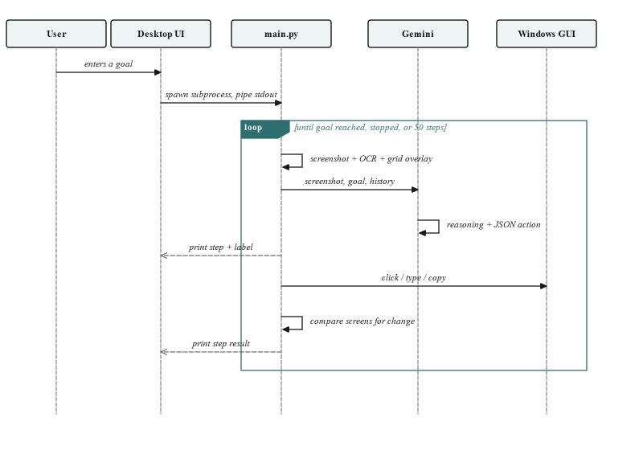
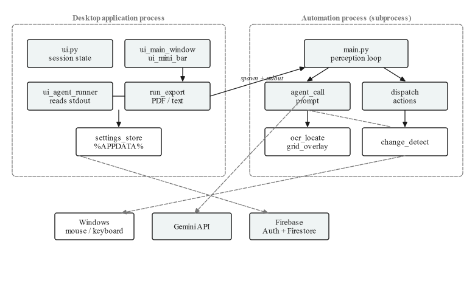
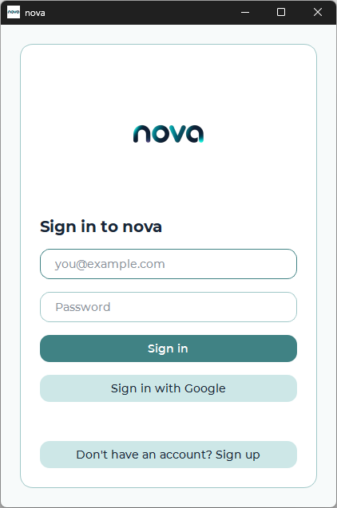

# nova – a vision-driven desktop agent

Senior project, German Jordanian University, 2025/2026 (solo). Grade: 97/100.

nova is a Windows desktop agent that takes a goal written in plain English, for example *"search for the PyAutoGUI docs, copy three code examples and email them to me"*, and carries it out through the graphical interface the way a person would: it looks at the screen, decides what to do, and moves the real mouse and presses real keys. It is not given a script, a recorded macro or element IDs. It is given a screenshot and a goal.

> **About the code:** this folder documents the project (design, architecture and evaluation). The source code is not published here yet.

## How it works

Every step runs one iteration of a perception-action loop:

1. **Capture** the screen (`mss`).
2. **Read** all on-screen text with Tesseract OCR, so visible words carry exact pixel coordinates, and draw a coordinate grid over the image.
3. **Decide:** send the annotated screenshot, the goal and the history of earlier steps to Gemini. The model returns a short justification plus exactly one structured JSON action.
4. **Act:** validate the action and perform it as real input (`pyautogui`).
5. **Check** whether the screen actually changed (pixel differencing with NumPy), and feed the result into the next step.

### Action vocabulary

`click`, `type`, `key`, `hotkey`, `open_app`, `scroll`, `select_all`, `drag_select`, `drag_scroll_select`, `copy`, `paste`, `wait`, `done`.

Two design choices worth pointing out:

- **Text selection is anchored to words, not guessed rectangles.** `drag_select` names the first and last word of the passage, and both are resolved through the OCR word list.
- **`copy` accumulates.** Copied items stack up and `paste` delivers them together. This came directly out of the evaluation below.

## Architecture

The desktop app and the automation loop run as separate processes. The UI spawns the agent as a subprocess and reads its step-by-step transcript from stdout.

| Desktop application | Automation core |
|---|---|
| Floating command bar on a global hotkey (Ctrl+Alt+N) | `main.py` – the perception-action loop |
| Live feed of every step in plain language | `agent_call.py` – model call, image downscaling, watchdog, JSON retry |
| Firebase sign-in and per-user task history | `dispatch.py` – action validation, routing, chain stop conditions |
| Export of any run as PDF or text | `ocr_locate.py`, `grid_overlay.py`, `change_detect.py` |
| Runs from the tray, single instance via local socket | `actions.py` – mouse/keyboard input, adaptive waiting |

API keys and Firebase settings live in a JSON file under the user's application data folder and are set from the settings screen, so the code itself contains no secrets.

More design diagrams: [use cases](docs/fig_2_1_use_case.png) · [class diagram](docs/fig_2_4_class.png) · [data model](docs/fig_2_5_data_model.png)

## Evaluation

**Benchmark task:** search the web, extract three separate code examples from a documentation page, and send them by email. This crosses a browser and a mail client.

**Baseline:** 10 identical, unmodified runs. Only 3 of 10 delivered all three examples. Reading the recorded transcripts (the model's justification is logged at every step) showed the failures shared one cause: the clipboard policy refused a second copy until the first had been pasted, which left the agent with no way forward and cost up to 44 wasted steps in one run.

**Fixes:** (1) make `copy` accumulate items instead of refusing, and (2) stop a batch of chained actions when a click leaves the screen still changing.

| Measure | 10 baseline runs | 5 runs after fixes |
|---|---|---|
| All three examples delivered | 3 of 10 | 5 of 5 |
| Copy rejections per run | 2 to 44 | 0 in every run |
| Steps per run | 18 to 50 (median 21) | 11 to 15 (median 14) |
| Runs hitting the 50-step limit | 1 | 0 |
| Email sent successfully | 5 of 10 | 4 of 5 |

**Limitations, stated honestly:** the samples are small (the second set was cut to five runs by the model's daily request limit), all runs used one task on one machine, and two minor defects remain (an occasional duplicate compose window and, once in fifteen runs, a recipient field that wasn't ready for the first keystrokes).

Across development the agent logged 297 complete runs and 4,260 steps over fifteen days.

## Tech

Python 3 · PySide6 (Qt) · google-genai (Gemini) · pyautogui · mss · Pillow · NumPy · pytesseract + Tesseract OCR 5 · pyperclip · requests (Firebase Auth and Firestore REST) · Git

## How to run

The source is not in this repository yet, so nova can't be run from here. Running it needs Windows, Python 3, the Tesseract OCR binary, a Gemini API key, and a Firebase project for accounts and history.
